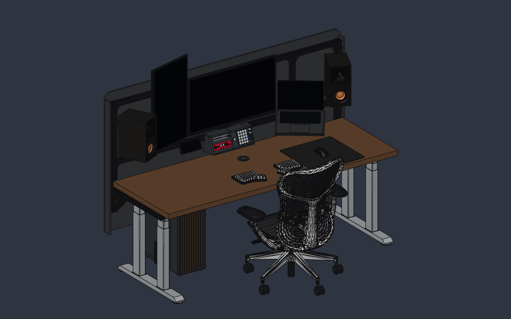

# Desk rail system

[](PROJECT.md)
[](docs/EXTRUSION_GUIDE.md)
[](AGENTS.md)
[](LICENSE)
[](https://github.com/msetsma/desk-rail-system/commits/main)

Parametric CAD model of a sit-stand desk: a DeskHaus Apex Pro 4-leg frame, the desktop, and a
Misumi HFS5 extrusion rail system carrying two monitors, Klipsch R-40M speakers, a hanging PC, a
laptop mount, felt privacy and side panels, and a 3D-printed console with a cable grommet.



## Built agentically

Claude Code drives SolidCraft over its MCP interface and builds, edits, measures and checks the
model while a human reviews and steers. The repo doubles as a testbed for agent-driven CAD:

- [`docs/solidcraft-agent-improvements.md`](docs/solidcraft-agent-improvements.md): how the agent
  works with SolidCraft today, and what would let it work natively.
- [`AGENTS.md`](AGENTS.md): living rules with an improvement log, updated whenever a session learns
  something. Project facts and SolidCraft quirks are in [`PROJECT.md`](PROJECT.md).
- [`.claude/skills/cad-best-practices/`](.claude/skills/cad-best-practices/SKILL.md): reusable CAD
  modelling practices.

> [!NOTE]
> Vendor CAD downloads (Misumi, Razer, DeskHaus, ZSA, Fractal, Gigabyte, Herman Miller) stay local
> because their licenses don't allow redistribution; paths to them in the docs are references.

## Layout

| Path | What |
|---|---|
| `desk_rails.solidcraft` | the assembly: linked part files placed by joints, no geometry of its own (Git LFS) |
| `skeleton/params.json` | shared layout and `MEASURE` parameters read by the assembly and size-driven parts |
| `parts/` | one frozen `.solidcraft` per real part; `parts/lib/` holds purchased hardware ([list](parts/lib/README.md)) |
| `parts/src/` | part scripts and their generators. A script marked `"generated_by"` is regenerated, so edit its generator |
| `tools/` | build, regen, check, BOM, clearance, sightline and sweep scripts (below) |
| `variants/` | layout variants as skeleton overrides; `desk_62x32` builds `desk_rails_62x32.solidcraft` (D17) |
| `docs/` | [extrusion rules + decision log](docs/EXTRUSION_GUIDE.md), [part build spec](docs/PART_BUILD_SPEC.md), [visual joint review](docs/visual_joint_review.md) |
| `refs/`, `profiles/` | reference photos and drawings; extrusion cross-section DXFs |
| `tests/` | pytest checks of the laid-speaker maths (`spk_laid.py`, `build_variant.py`) |
| `BOM.md` | generated bill of materials (`tools/bom.py`), don't hand-edit |

## Workflow

```sh
# 1. edit skeleton/params.json (inches are fine: "30 in")
python tools/regen_parts.py          # 2. rebuild the parts that changed (prefix arg: FRM-03)
python tools/build_assembly.py --out desk_rails.solidcraft   # 3. rebuild the assembly (~20 s)
```

For 1-3 changed parts, refresh just those links in the live app instead of step 3:
`component.update_links {"component": "<name>"}` (the bare `update_links {}` re-evaluates every
link, ~40 s). After a rebuild, run `new_design` then `open` in the app.

Checks:

```sh
python tools/near_check.py <body prefixes>   # clearance of changed bodies vs neighbours (~4 s)
python tools/sightlines.py                   # eye-point ray casts, laptop fit
python tools/check.py [--renders]            # full report, overlaps, audit, BOM (slow)
```

Other tools: `audit.py` (mass, tip margins, sag, joint loads), `sweep.py` (parallel parameter
sweeps), `build_variant.py`, `skeleton_values.py`, `eval_bodies.py`, `mesh_step.py`, `svg2dxf.py`,
`spk_laid.py`. The `.solidcraft` files are binary, so git history is the undo.

## Assemblies

The root holds only group components (`DSK-00` grounded); every part is placed by a joint driven by
skeleton parameters. Axes: origin on the floor under the frame centre, X right, Y toward the wall, Z up.

<details>
<summary>Parts: 52 part numbers (44 files + 8 library), 120 parts</summary>

| Group | Part file (`parts/`) | Count | What | Finish |
|---|---|---|---|---|
| `DSK-00` Desk frame | `DSK-01_Desktop` | 1 | desktop, IKEA KARLBY | walnut veneer |
| | `DSK-02_TopSupport` | 2 | Apex Pro top support, an L-angle the desktop screws to | DeskHaus Silver |
| | `DSK-03_ChannelBar` | 4 | slim bars running left-right; the legs sit between them | DeskHaus Silver |
| | `DSK-04_Leg` | 4 | lifting column (envelope) | DeskHaus Silver |
| | `DSK-05_Foot` | 2 | foot with glides | DeskHaus Silver |
| `FRM-00` Monitor rail frame | `FRM-01_Upright_4040` | 2 | rear posts | black anodized (HFSB5) |
| | `FRM-02_Crossbar_2040` | 2 | lower and upper monitor bars | black anodized |
| | `FRM-03L_SideRail_L_4040`, `FRM-03R_SideRail_R_4040` | 1 + 1 | side rails, each drilled for 4 M6 through-bolts (D9, D15) | black anodized |
| | `FRM-04_Stile_2040` | 3 | vertical bars between the crossbars; the monitors and the laptop arm mount to these | black anodized |
| | `FRM-05_Modesty_panel` | 1 | privacy panel behind the posts, 12 mm PET felt, R50 top corners, on standoffs (D22) | dark grey felt |
| | `FRM-06_Brace_2040` | 2 | 45° knee brace under each side rail (D20) | black anodized |
| | `FRM-07L_HangerPlate_L`, `FRM-07R_HangerPlate_R` | 1 + 1 | 5 mm steel hanger plate on the top-support flange; the side rail hangs from it (D21) | black powder coat |
| | `FRM-08_SidePanel` | 2 | felt side panel on each upright's outer face (D22) | dark grey felt |
| `HW-00` Frame hardware | `lib/HW-L01_HPTTD5` | 4 | Misumi T-joining plate, side rail to upright, outer and inner faces | painted black |
| | `lib/HW-L02_HPTLD5` | 4 | Misumi L-joining plate, crossbar ends | painted black |
| | `lib/HW-L03_HBLFSN5` | 16 | Misumi 1-slot gusset (ordered black, HBLFSNB5), crossbar and stile joints | black anodized |
| | `lib/HW-L05_HBL45TD5` | 4 | Misumi 2-slot 45° bracket, knee-brace ends (D20) | painted black |
| | `lib/HW-L06_HBLTDB5` | 2 | Misumi 2-slot gusset under each side rail (D23) | black anodized |
| | `lib/HW-L10_M6x55_SHCS` | 8 | M6x55 socket-head screw, side rail to top support | black oxide |
| | `lib/HW-L11_Standoff_M5x12` | 14 | standoffs for the privacy and side panels | black |
| | `lib/HW-L12_HFC5-4040-B` | 6 | Misumi end cap on the free 4040 ends (D23) | black |
| `MON-00` Monitors | `MON-01_Monitor_Main_32in` | 1 | 32in 16:9 main | near-black |
| | `MON-02_Monitor_Side_27in` | 1 | 27in portrait, left | near-black |
| `SPK-00` Speakers | `SPK-01_R40M_Speaker` | 2 | Klipsch R-40M, aimed at the eye point | black, copper woofer |
| | `SPK-02_SpkMount_Flange` | 2 | mount plate in the upright front slot | black |
| | `SPK-03_SpkMount_Block` | 2 | arm block | black |
| | `SPK-04_SpkMount_Swivel` | 2 | ball swivel | black |
| `PC-00` PC under-desk | `PC-01_FractalNorth` | 1 | Fractal North case | dark grey |
| | `PC-02_WalnutSlatFront` | 1 | walnut slat front | walnut |
| | `PC-03_Strap` | 1 | 6in x 1/2in strap under the channel bars | black |
| `INP-00` Input devices | `INP-01_MousePad` | 1 | 16.5in mouse pad | black |
| | `INP-02_DeathAdderV3Pro` | 1 | Razer DeathAdder V3 Pro, real vendor STEP | vendor colors |
| | `INP-03_ErgoDoxEZ_Left`, `INP-04_ErgoDoxEZ_Right` | 1 + 1 | ErgoDox EZ halves, outline traced from ZSA's 1:1 printout | black |
| `LAP-00` Laptop | `LAP-01_LaptopMount` | 1 | user-built mount (placeholder) on the right stile's front slot (D19) | black |
| | `LAP-02_MacBookPro14` | 1 | MacBook Pro 14in, reference model | space black |
| | `LAP-03_LaptopTray` | 1 | user-built tray (placeholder) | black |
| `CHR-00` Chair | `CHR-01_HermanMillerMirra2` | 1 | Herman Miller Mirra 2, Butterfly back, from the vendor 3D DWG | studio white, fog, graphite |
| `ACC-00` Crossbar console | `ACC-01_Grommet` | 1 | desk cable grommet in a drilled 60 mm hole (D24) | printed charcoal |
| | `ACC-02_Bay_Audio` | 1 | console bay: Scarlett Solo and USB hub set flush (D24) | printed charcoal |
| | `ACC-05_Bay_duckyPad` | 1 | console bay: KVM key and duckyPad Pro set flush (D24) | printed charcoal |
| | `ACC-06_Inlay` | 1 | light grey inlay line along the console face | printed light grey |
| | `ACC-07_PhoneStand` | 1 | phone stand on the lower bar holding the MagSafe puck (D24) | printed charcoal |
| | `ACC-11` … `ACC-17` | 1 each | device references: Scarlett Solo 3rd Gen, ABFCRTTW hub, iPhone 16 Pro Max, MagSafe charger, fingerprint dongle, duckyPad Pro, KVM key | vendor colors |
| `REF-00` Skeleton | (no part file) | | `SKL_Eye`: a sketch point at the seated eye position, not a body | red |

Hardware occurrences are named `HW-01` to `HW-58` by job (`HW-07 Gusset side rail L (HBLTDB5)`).
Mirror-image parts (side rails, hanger plates, keyboards) have L and R files; other pairs reuse one
file turned 180°. `HW-L04` (retired HBLFSD5) and `SPK-05` (62x32 variant only) aren't in the main
assembly.

</details>

Saved views: Overview, Front, Back, SideRailJoint_R/L, SpeakerMount_R, UnderDesk, LaptopArm, Rails,
RailsBack, Desk, DeskRails. Display rows (`config.activate`): Full, Frame only, No desktop, Monitors +
speakers, Rails only, Desk only, Desk + rails, No chair. Views don't carry a row, so pair
`Rails`/`RailsBack`, `Desk` and `DeskRails` with their row by hand.

## Key parameters

Set in `skeleton/params.json`; the rest are derived. ★ = favourite.

| Parameter | Default | What it does |
|---|---|---|
| `desk_h` ★ | 26.5 in | desktop top height above the floor (sit or stand) |
| `desk_w` ★, `desk_d` ★ | 74 in, 26 in | desktop width and depth; the frame width follows `desk_w` |
| `mon_clearance` ★ | 8 in | gap from the desktop to the bottom of the monitors |
| `pc_w` ★, `pc_leg_gap` ★ | 215 mm, 2 in | PC case width, and its gap from the left leg |
| `kb_gap` ★ | 100 mm | gap between the keyboard halves |
| `desk_t` | 1.5 in | desktop thickness |
| `up_side_inset` | 0 in | side rail and upright inset from the desktop edge |
| `rear_gap` | 10 mm | desktop back edge to the upright front face |
| `m1_x`, `mon_gap` | 0, 10 mm | main monitor position, gap between monitors |
| `m1_tilt`, `m3_yaw` | 0°, 15° | tilts both monitors back; turns the side monitor in |
| `bar1_gap` | 65 mm | lower crossbar top below the monitors (room for printed accessories, D18) |
| `spk_bot`, `spk_yaw_max` | `mon_clearance`, 25° | speaker height; toe-in limit (tilt and toe-in aim at the eye point) |
| `pnl_drop`, `pnl_cover` | 14 in, `pnl_r` + 15 mm | panel drop below the desk; panel rise above the posts |
| `pnl_r` | 50 mm | privacy panel top-corner radius |
| `brace_leg` | 150 mm | knee-brace leg along the upright and the rail (D20) |
| `hang_t` | 5 mm | hanger plate thickness; the frame sits this much lower (D21) |
| `con_x`, `con_top` | 0, 10 mm | console centre x; console top above the lower crossbar |
| `grom_y`, `grom_d` | 144 mm, 60 mm | desk grommet hole position (y) and diameter |
| `eye_above_desk`, `eye_back` | 46 in - `desk_h`, 6 in | eye point above the desk and in front of its edge |

## Measure checklist

Parameters whose comment in `params.json` says `MEASURE` are estimates until measured. Ticked items
were measured or confirmed (the comment says how and when). Inches are fine.

<details>
<summary>Frame, monitors, speakers, PC, inputs, laptop, chair, console</summary>

**Top supports** (`DSK-02`; `frame_w` is derived from `desk_w`, the channel bars get cut to suit)
- [x] `ts_len`, `ts_w`, `ts_h`: length (Y), width (X), height (Z) (2026-10-29)
- [x] `ts_t`: sheet steel thickness (photo estimate, confirmed by the user 2026-10-29)
- [x] `ts_bolt_pitch`: spacing of the 2 leg screws per column (Y) (2026-10-29)
- [x] `ts_bolt_z`: leg screw center below the frame top (sets the side rail holes, D9) (2026-10-29)
- [ ] `ts_lip`: web lip height left at the tapered flange tips

**Channel bars** (`DSK-03`)
- [x] `ch_h`, `ch_bar_w`, `ch_bar_gap`, `ch_y_off` (2026-10-29)

**Legs and feet** (`DSK-04`, `DSK-05`)
- [x] `leg_x`, `leg_y`, `leg_yc`: stage sizes and frame center to leg center (2026-10-29)
- [x] `foot_w`, `foot_h`: width and height with glides (2026-10-29)
- [ ] `foot_len`: foot length (Y)

**Side rails** (`FRM-03L/R`)
- [ ] leg column thread depth: the M6x55 needs 12 mm of free thread (stock M6x14 uses 11)

**Hanger plates** (`FRM-07L/R`, D21: check before ordering)
- [ ] `ds_head_r`: desktop wood-screw head radius (estimate)
- [ ] M5x12 countersunk screw against the HNTT5-5 valid screw range
- [ ] weld bumps or bosses on the real top-support flange

**Monitors** (`MON-01` from the Gigabyte M32U manual; `MON-02` generic until picked)
- [x] `m1_w`, `m1_h`, `m1_t`: from the manual
- [ ] `m1_vesa_dz`: VESA centre above the screen centre (manual drawing, +/-0.5 mm)
- [ ] `m3_w`, `m3_h`, `m3_t`: side monitor width, height, max depth with the rear bulge
- [ ] `mon_panel_t`: thin edge thickness
- [ ] `vesa_adp`, `mon_standoff`: VESA adapter outside size and thickness (adapter not chosen yet)

**Speakers** (`SPK-01`)
- [ ] `spk_horn`: horn faceplate size
- [ ] `spk_wf_d`: woofer outside diameter with trim ring
- [ ] `spk_tw_down`: tweeter center below the top
- [ ] `spk_mount_frac`: swivel height on the back, as a fraction of speaker height

**PC and inputs** (`PC-02`, `PC-03`, `INP-01`, `INP-03/04`)
- [ ] `slat_t`, `slat_inset`: slat depth and setback from the case front
- [ ] `strap_t`, `strap_lip`: strap thickness and left lip rise
- [ ] `pad_t`: mouse pad thickness
- [ ] `kb_case_h`: ErgoDox EZ case height

**Laptop and chair** (`LAP-01..03`, `CHR-01`)
- [ ] `lap_hinge_r`: tray hinge barrel radius (user-built jig)
- [ ] LAP-01 base plate screws: 2 x M5x12 into T-nuts in the right stile's front slot (estimate)
- [ ] `chr_eye_dy`: seated eye Y from the chair cylinder axis

**Console devices** (`parts/src/ACC_layout.py`, not skeleton parameters)
- [ ] Scarlett Solo 3rd Gen: ~144 x 96 x 44 mm
- [ ] iPhone 16 Pro Max in its case: ~168 x 82 x 12 mm
- [ ] fingerprint dongle: ~30 x 15 x 7 mm
- [ ] USB hub: 130 x 30 x 17 mm and port positions (from listings)

**Ergonomics**
- [x] `eye_above_desk`: measured 2026-10-29 (seated eye 46 in above the floor, minus `desk_h`)
- [ ] `eye_back`: eyes out from the desktop front edge

Not parameters, but worth noting: weights of the monitors, speakers and laptop mount (for
`tools/audit.py`), the desk back edge to the wall, and your usual sit and stand heights.

</details>

## Frame

Misumi HFS5 only, ordered black anodized as HFSB5 (D23). Cross-sections in `profiles/`:

| Profile | Used for | Source |
|---|---|---|
| HFS5-4040 (497 mm²) | uprights, side rails | SVG from github.com/TheEnigmaBlade/dllpdf-frame-calculator (no license stated), via `tools/svg2dxf.py` |
| HFS5-2040 (323 mm²) | crossbars, stiles, knee braces | github.com/oysteinkrog/thing_libutils (LGPL-2.1) |

Each 4040 side rail runs along a top support's outer face and butts the upright (T-joint, D1):
HPTTD5 T-plates and an HBLTDB5 gusset at the upright (D2, D23), a 45° knee brace with HBL45TD5
brackets (D20), a 5 mm steel hanger plate on the top-support flange that the rail hangs from (D21),
and 4 M6x55 screws per side through the rail and top support into the leg columns (D9). End caps
close the free ends (D23). Details and reasoning are in the
[decision log](docs/EXTRUSION_GUIDE.md).

## License

[MIT](LICENSE) for the design, docs and tools. Extrusion profile DXFs keep their upstream licenses
(see above).
