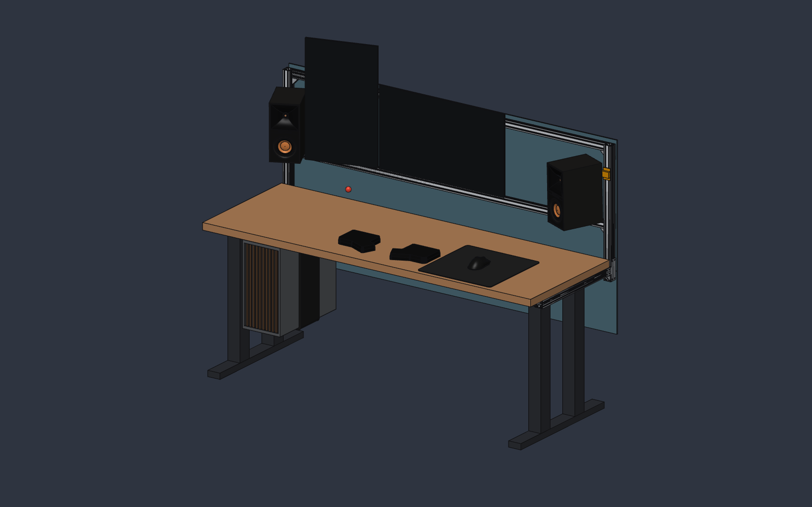
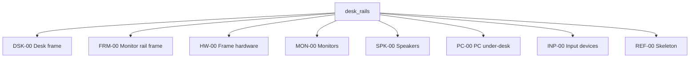

# Desk rail system

[](PROJECT.md)
[](docs/EXTRUSION_GUIDE.md)
[](AGENTS.md)
[](LICENSE)
[](https://github.com/msetsma/desk-rail-system/commits/main)

Parametric CAD model of a sit-stand desk: a DeskHaus Apex Pro 4-leg frame (Jiecang OEM), the
desktop, and a Misumi HFS5 aluminium extrusion rail system that carries two monitors, Klipsch R-40M
speakers, a hanging PC and a modesty panel.



## Built agentically

The design is developed agentically: an AI coding agent (Claude Code) drives SolidCraft over its
MCP control interface and builds, edits, measures and checks the model while a human reviews and
steers. The project doubles as a testbed for:

- **SolidCraft's agent integration**: what works well, what doesn't, and the quirks found along the
  way (logged in `PROJECT.md`).
- **Skills and agents for CAD work**: reusable instructions such as
  `.claude/skills/cad-best-practices/`, plus the living rule set in `AGENTS.md`, which gets updated
  (with an improvement log) every time a session learns something.

Expect the repo to change often while that workflow is worked out.

> [!NOTE]
> Raw vendor downloads (Misumi, Razer, DeskHaus, ZSA) are kept local only and aren't in this repo,
> since their licenses don't allow redistribution. The paths to them in the docs are references.

## Files

- `desk_rails.solidcraft`: the **assembly**. It holds no geometry of its own, only linked part
  files placed with joints. Open it in SolidCraft. Stored with Git LFS, like every `.solidcraft` file.
- `skeleton/params.json`: the shared parameters (layout and `MEASURE` values). The assembly and
  every size-driven part read it. `skeleton/hw_placements.json` places the hardware.
- `parts/`: one file per real part (`parts/<PN>_<Name>.solidcraft`), each built around its own origin.
  - `parts/src/`: the build script for each part. The script is the source of truth; the
    `.solidcraft` file is its output.
  - `parts/lib/`: purchased hardware (Misumi plates and gussets, screws, standoffs), one file each,
    named by vendor part number. See `parts/lib/README.md`.
  - `parts/_template.json`: materials and settings every new part starts from.
- `legacy/desk_rails_legacy.solidcraft`: the old single-timeline model. Reference only.
- `tools/`:
  - `regen_parts.py`: pushes the skeleton parameters into the size-driven parts and rebuilds them.
  - `build_assembly.py`: builds the whole assembly from scratch (inserts and places every part).
  - `assembly_finish.py`: second pass after a build: materials, properties, views, display rows.
  - `check.py`: one-command body report, overlap check, audit and BOM (see below).
  - `bom.py`: writes `BOM.md` from the part numbers in the assembly.
  - `audit.py`: structure and balance audit (mass, tip margins, leg split, crossbar sag, joint
    loads). Edit `SPEC_KG` when things are weighed.
  - `eval_bodies.py`: maps the bodies in the assembly back to their part and placement names.
  - `svg2dxf.py`: converts an SVG profile drawing to DXF (used once for the HFS5-4040 profile).
- `BOM.md`: generated bill of materials. Don't hand-edit it.
- `docs/`: `EXTRUSION_GUIDE.md` (extrusion rules + decision log; check it before any extrusion
  decision), `PART_BUILD_SPEC.md` (rules and part-number list for part files),
  `COMPLIANCE_PLAN.md` (how the project got this structure), `images/`.
- `refs/`: reference photos, drawings and data sheets (vendor downloads are local only).
- `profiles/`: extrusion cross-section DXFs.
- `renders/`: snapshots.

## Workflow

Change a size:

1. Edit the value in `skeleton/params.json` (or change it in the assembly's Parameters table and
   export it there with `parameters.export`).
2. Run `python tools/regen_parts.py`. It rebuilds every part whose size depends on the skeleton.
   Add a prefix (`python tools/regen_parts.py FRM-03`) to rebuild only some.
3. In the assembly, run `component.update_links {}` (or reopen it). The parts refresh and the
   joints move them to their new places.

Rebuild the whole assembly from scratch:

```sh
python tools/build_assembly.py --out desk_rails.solidcraft
```

It also runs `tools/assembly_finish.py`, since links don't carry materials or properties.

Check (one command, reads the saved design, never overwrites it):

```sh
python tools/check.py            # report, overlap check, audit, BOM.md
python tools/check.py --renders  # also refresh renders/iso|front|back|right|top.png
```

It exits non-zero if the report fails or any bodies overlap. Outputs (report JSON,
interference results) go to `build/` (git-ignored). The check is slow, so run it before a commit,
not after every change. The `.solidcraft` files are binary, so git history is the undo
(`git checkout <rev> -- desk_rails.solidcraft parts/`).

## Assemblies

The root holds only the group components. Each group holds linked part files. A part number belongs
to the part **file**; a file used twice shows up twice. `DSK-00` is grounded. Every other part is
placed by a joint from the root origin, driven by skeleton parameters.



| Group | Part file (`parts/`) | Count | What | Finish |
|---|---|---|---|---|
| `DSK-00` Desk frame | `DSK-01_Desktop` | 1 | desktop slab | butcher block |
| | `DSK-02_TopSupport` | 2 | Apex Pro top support, an L-angle the desktop screws to | DeskHaus Silver |
| | `DSK-03_ChannelBar` | 4 | slim bars running left-right; the legs sit between them | DeskHaus Silver |
| | `DSK-04_Leg` | 4 | lifting column (envelope) | DeskHaus Silver |
| | `DSK-05_Foot` | 2 | foot with glides | DeskHaus Silver |
| `FRM-00` Monitor rail frame | `FRM-01_Upright_4040` | 2 | rear posts | aluminium |
| | `FRM-02_Crossbar_2040` | 2 | lower and upper monitor bars | aluminium |
| | `FRM-03L_SideRail_L_4040`, `FRM-03R_SideRail_R_4040` | 1 + 1 | side rails, drilled for 8 through-bolts each (D9, D15) | aluminium |
| | `FRM-04_Stile_2040` | 2 | vertical bars between the crossbars; the monitors mount to these | aluminium |
| | `FRM-05_Modesty_panel` | 1 | privacy panel behind the posts, on standoffs | slate |
| `HW-00` Frame hardware | `lib/HW-L01_HPTTD5` | 2 | Misumi T-joining plate, side rail to upright | zinc |
| | `lib/HW-L02_HPTLD5` | 4 | Misumi L-joining plate, crossbar ends | zinc |
| | `lib/HW-L03_HBLFSN5` | 14 | Misumi gusset bracket | cast aluminium |
| | `lib/HW-L10_M6x20_SHCS` | 16 | M6x20 socket-head screw, side rail to top support | black oxide |
| | `lib/HW-L11_Standoff_M5x12` | 8 | panel standoff | zinc |
| `MON-00` Monitors | `MON-01_Monitor_Main_32in` | 1 | 32in 16:9 main | near-black |
| | `MON-02_Monitor_Side_27in` | 1 | 27in portrait, left | near-black |
| `SPK-00` Speakers | `SPK-01_R40M_Speaker` | 2 | Klipsch R-40M, aimed at the eye point | black, copper woofer |
| | `SPK-02_SpkMount_Flange` | 2 | mount plate in the upright front slot | black |
| | `SPK-03_SpkMount_Block` | 2 | arm block | black |
| | `SPK-04_SpkMount_Swivel` | 2 | ball swivel | black |
| `PC-00` PC under-desk | `PC-01_FractalNorth` | 1 | Fractal North case | dark grey |
| | `PC-02_WalnutSlatFront` | 1 | walnut slat front | walnut |
| | `PC-03_Strap` | 1 | 6in x 1/2in strap under the channel bars | black |
| `INP-00` Input devices | `INP-01_MousePad` | 1 | 16.5in mouse pad | black |
| | `INP-02_DeathAdderV3Pro` | 1 | Razer DeathAdder V3 Pro, real vendor STEP | vendor colors |
| | `INP-03_ErgoDoxEZ_Left`, `INP-04_ErgoDoxEZ_Right` | 1 + 1 | ErgoDox EZ halves, outline traced from ZSA's 1:1 printout | black |
| `REF-00` Skeleton | (no part file) | | `SKL_Eye`: a sketch point at the seated eye position, not a body | red |

That's 29 part numbers and 83 parts in total (see `BOM.md`). The hardware occurrences are named
`HW-01` to `HW-36` by job (`HW-07 Gusset side rail L`). Side rails and keyboards have L and R files
because they're mirror images; the other pairs reuse one file, turned 180°.

Saved views: Overview, Front, Back, SideRailJoint_R/L, SpeakerMount_R, UnderDesk. Display rows
(`config.activate`): Full, Frame only, No desktop, Monitors + speakers.

Axes: origin = floor under frame center. X = width (+ right), Y = depth (+ toward wall), Z = up.

## Key parameters

Set them in `skeleton/params.json`, then follow the [workflow](#workflow). Inches are fine
(`"30 in"`). ★ = favourite.

| Parameter | Default | What it does |
|---|---|---|
| `desk_h` ★ | 30 in | desktop top height above the floor (sit or stand) |
| `desk_w` ★, `desk_d` ★ | 70 in, 30 in | desktop width and depth; the frame width follows `desk_w` |
| `mon_clearance` ★ | 8 in | gap from the desktop to the bottom of the monitors |
| `pc_w` ★, `pc_leg_gap` ★ | 215 mm, 2 in | PC case width, and its gap from the left leg |
| `kb_gap` ★ | 100 mm | gap between the keyboard halves |
| `desk_t` | 1.5 in | desktop thickness |
| `up_side_inset` | 0 in | side rail and upright inset from the desktop edge |
| `rear_gap` | 10 mm | desktop back edge to the upright front face |
| `m1_x`, `mon_gap` | 0, 10 mm | main monitor position, gap between monitors |
| `m1_tilt`, `m3_yaw` | 0°, 15° | tilts both monitors back; turns the side monitor in |
| `bar1_gap` | 25 mm | lower crossbar top below the monitors |
| `spk_bot`, `spk_yaw_max` | `mon_clearance`, 25° | speaker height; toe-in limit (tilt and toe-in aim at the eye point) |
| `pnl_drop`, `pnl_cover` | 14 in, 15 mm | panel drop below the desk; panel rise above the posts |
| `eye_above_desk`, `eye_back` | 16 in, 6 in | eye point above the desk and in front of its edge |

The other parameters are derived, so leave them alone. Each one has a comment in `params.json`.

## Measure checklist

These parameters are marked `MEASURE` in `params.json`: they're estimates until measured.
Inches are fine.

<details>
<summary>Frame, monitors, speakers</summary>

**Top supports** (`DSK-02`; `frame_w` is derived from `desk_w`, the channel bars get cut to suit)
- [ ] `ts_len`, `ts_w`, `ts_h`: length (Y), width (X), height (Z)
- [ ] `ts_t`: sheet steel thickness
- [ ] `ts_bolt_pitch`: spacing of the 2 leg screws per column (Y)
- [ ] `ts_bolt_z`: leg screw center below the frame top (sets the side rail holes, D9)

**Channel bars** (`DSK-03`)
- [ ] `ch_h`: height (Z)
- [ ] `ch_bar_w`: width of one bar (Y)
- [ ] `ch_bar_gap`: gap between the 2 bars of one channel (now = `leg_y`)
- [ ] `ch_y_off`: only if the legs aren't centered front to back (else 0)

**Legs and feet** (`DSK-04`, `DSK-05`)
- [ ] `leg_x`, `leg_y`: top stage size (X, Y)
- [ ] `leg_yc`: frame center to leg center (Y). Easier: measure front leg center to back leg
  center and halve it.
- [ ] `foot_w`, `foot_h`: width and height with glides

**Side rails** (`FRM-03L/R`)
- [ ] `sr_seat_t`: inner wall thickness where the access hole stops (bolt head seat)

**Monitors** (`MON-01`, `MON-02`; no stand, a ruler is fine)
- [ ] `m1_w`, `m1_h`, `m1_t` and `m3_w`, `m3_h`, `m3_t`: width, height, max depth with the rear bulge
- [ ] `mon_panel_t`: thin edge thickness
- [ ] `vesa`: VESA hole pattern size
- [ ] `vesa_adp`: VESA adapter outside size

**Speakers** (`SPK-01`)
- [ ] `spk_horn`: horn faceplate size
- [ ] `spk_wf_d`: woofer outside diameter with trim ring
- [ ] `spk_tw_down`, `spk_wf_down`: tweeter and woofer centers below the top
- [ ] `spk_mount_frac`: swivel height on the back, as a fraction of speaker height

**Ergonomics**
- [x] `eye_above_desk`: measured 2026-10-27 (seated eye ~46 in above the floor)
- [ ] `eye_back`: eyes out from the desktop front edge

Not parameters, but worth noting: weights of the monitors and speakers (for `tools/audit.py`),
the desk back edge to the wall, and your usual sit and stand heights.

</details>

## Extrusion profiles

Real cross-sections (DXF, mm, centered) in `profiles/`. The extrusion part files sketch them and
extrude them to parameter lengths. Only Misumi HFS5 is used. The 80/20 and V-slot variants are
retired (D16); their DXFs stay in `profiles/` for reference.

| Profile | File | Used for | Source |
|---|---|---|---|
| HFS5-4040 | `misumi_hfs5_4040.dxf` | uprights, side rails | converted from an SVG drawing in github.com/TheEnigmaBlade/dllpdf-frame-calculator (no license stated) via `tools/svg2dxf.py` |
| HFS5-2040 | `misumi_hfs5_2040.dxf` | crossbars, stiles | github.com/oysteinkrog/thing_libutils (LGPL-2.1) |
| 80/20 (retired) | `8020_20-4040.dxf`, `8020_20-2040.dxf` | not used | github.com/Thaddeus-Maximus/designlib (no license stated) |
| V-slot (retired) | `openbuilds_vslot_4040.dxf`, `openbuilds_vslot_2040.dxf` | not used | 4040: github.com/alex-crr/ExtrusionsGenerator (MIT); 2040: github.com/richard-scott/OpenBuilds |

Checked cross-section areas: HFS5 4040 497 mm², 2040 323 mm².

## Side rail joints

Each 4040 side rail runs along the outer face of a top support. Its back end butts the upright's
front face, with the outer faces flush (a T-joint, D1).

- **To the upright** (D2): a Misumi HPTTD5 T-plate on the shared outer face, an HBLFSN5 gusset
  under the rail, and an end anchor inside the rail (not modelled).
- **To the top support** (D9): 8 M6x20 socket-head screws per side, through the rail into the
  top support. The rail needs drilling: an access hole in the outer face for the head and the key,
  then a clearance hole through the inner wall.

The plate sticks out 2.3 mm past the outer face. Set `up_side_inset` to at least that to keep it
inside the desktop edge.

## License

[MIT](LICENSE) for the design, docs and tools. Extrusion profile DXFs in `profiles/` keep their
upstream licenses (see the table above).
